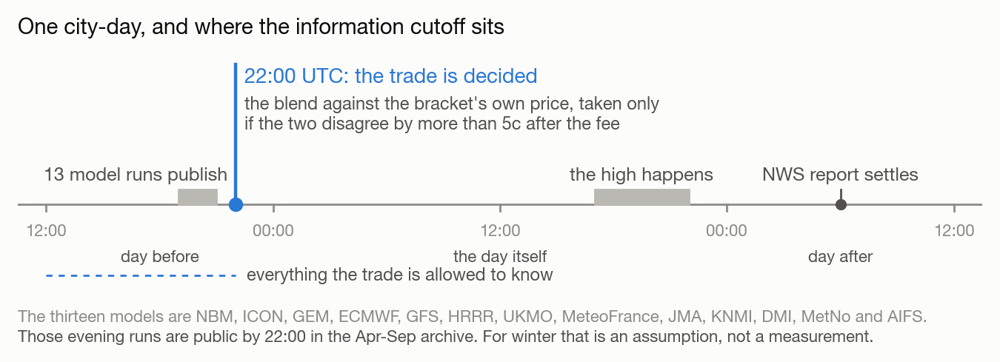
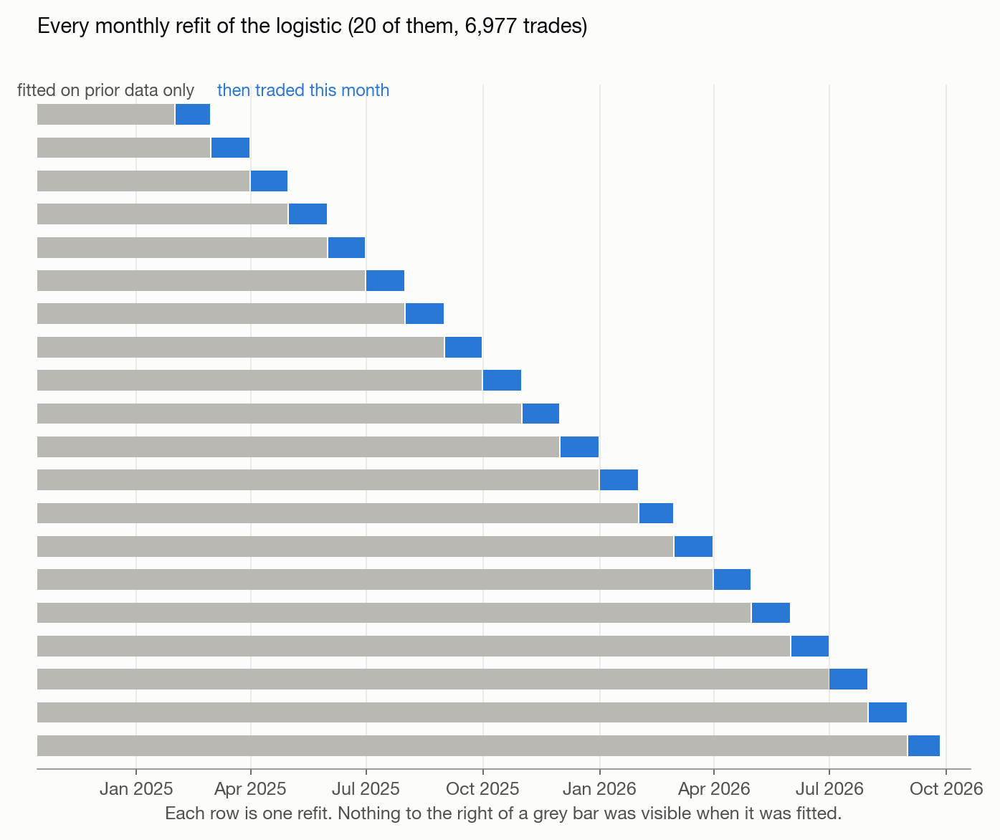
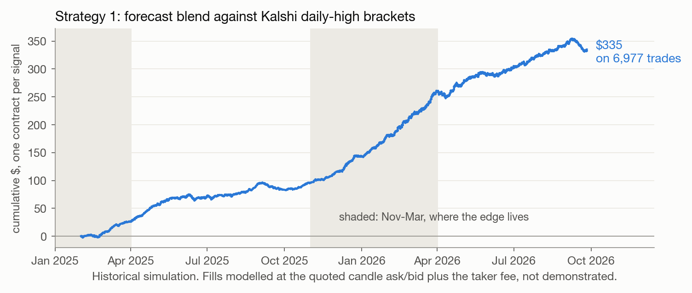
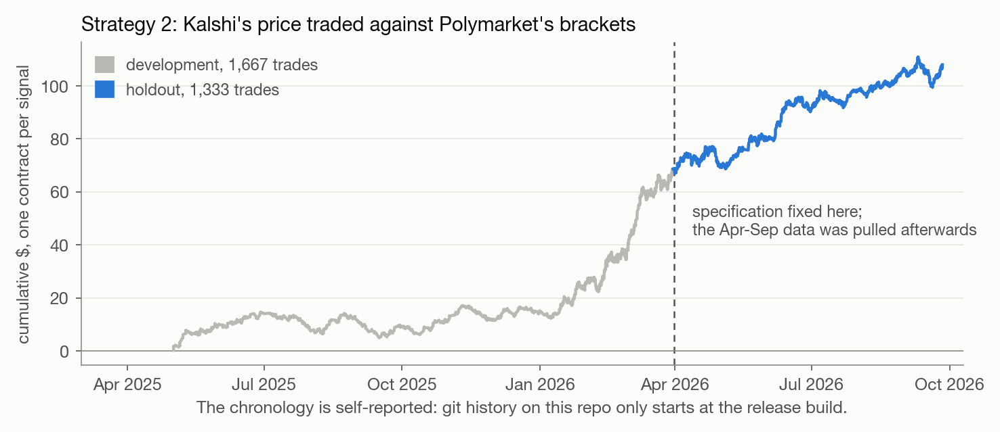

# isobar

Kalshi and Polymarket both list markets on the daily high temperature at a named
weather station: a row of two-degree buckets plus two open tails, settled on the
National Weather Service climate report for that station. Thirteen numerical
weather models publish a forecast for the same station every evening, for free.

The question this repo asks is whether the market fully prices that forecast. On
the evening before, across 18 stations and 21 months, it does not quite.

## The idea

Blend the thirteen models per station, bias-corrected, with weights fitted on
earlier years. Turn the blend into a probability for each bucket. Put that
probability and the bucket's own market price into a three-parameter logistic, so
the price stays in the model and the blend only has to add something on top. When
the combined number and the price disagree by more than 5 cents, take the bucket
at the quoted ask and hold it to settlement.

Two things make this worth writing down rather than just trading it. First, the
blend only improves on the price inside a narrow window, and the window is set by
when the forecasts become public:



Second, it is an information-processing edge and not a risk premium. Nobody is
being paid to take the other side, so it only survives while the marginal
participant has not bothered to pull the forecast. That is also why there is
almost nothing there in summer: Nov to Mar is +7.6c per contract, Jun to Sep is
+2.2c.

## How it is tested

Everything is walk-forward. Blend weights come from years before the target year;
the logistic is refit every month on prior months only, with a 120-event warm-up.
Twenty refits, 6,977 trades, and no fit ever sees the month it trades:



Inference is clustered on the event, because the six buckets of one city-day are
one bet rather than six. Shuffling the blend across days as a placebo drops its
fitted coefficient from 0.41 to 0.013, and what is left of the P&L is not
significant (t = 1.5). Leaving any single station out leaves the t-statistic
between 7.7 and 9.7.

## Results

Both results below are historical simulations. Fills are modelled at the quoted
candle ask or bid plus Kalshi's `0.07*P*(1-P)` taker fee. They are not demonstrated
fills, and nothing here has traded live.



+4.8c per contract on 6,977 trades, event-clustered t = 9.17, 66% of trades
positive, 7.9% return on cost. Return on capital is high, and the absolute size
it can carry is modest; the capacity figures are in RESULTS.md.

The second result came out of asking why the first one worked. If Kalshi's price
already contains most of the forecast, it should predict Polymarket's settlement
on the same city better than Polymarket's own price does. It does, by z = 8.34,
and by z = 5.54 with the weather blend also in the model, so it is not simply the
forecast arriving twice.



I fixed the specification on data through March 2026 and only then pulled the
April to September Polymarket history: +2.9c per contract on 1,333 trades,
t = 2.4, and +2.6c with the coefficients frozen rather than refit.

I first wrote this up as Kalshi leading price discovery, and have withdrawn that.
A standard per-contract VECM puts Kalshi's median information share at 0.40 rather
than the 0.74 to 0.81 I first reported, and 16% of same-station same-bucket
contracts settle differently across the two venues, so the pair was never
economically identical. What survives is the weaker claim: predictive information,
plus slow adjustment on Polymarket of about 2.7% of the gap per hour.

## Caveats

Three, briefly. The blend uses forecasts issued 24 hours ahead, which should be
public by 22:00 UTC, and I can only confirm that from single-run archives for April
to September 2026, so the winter months rest on that timing holding rather than on
a measurement. Fills are modelled from the quoted bid and ask rather than taken
from a real order book. And it is one winter, which is where most of the edge is.

None of that is loose testing, though. Parameters are walk-forward at every layer
and no fit ever sees the month it trades. The holdout specification was fixed
before the data existed. Inference is clustered on the event rather than the
contract, the placebo and the leave-one-station-out checks both hold, and
`make reproduce` regenerates every number in RESULTS.md from hashed inputs with 18
regression tests behind it. `results/STRATEGY_AUDIT.md` is me auditing my own
results; its closure table says what is fixed and what is still open.

## Reproduce

```bash
pip install -r requirements.txt
```

```bash
make reproduce   # rebuilds results/release/ and RESULTS.md from data/
make test        # 18 regression tests: dates, bounds, units, fees, leakage
```

`data/` is about 2 GB and is not in the repo. The downloaders in `scripts/` will
rebuild it from the Kalshi and Polymarket public APIs, Open-Meteo's forecast
archive, and NWS reports via the Iowa Environmental Mesonet. All of it is free and
none of it needs credentials. Budget hours, because both exchanges throttle.

`results/release/RESULTS.md` is generated, and it is the only place I quote
numbers from. `manifest.json` next to it carries input hashes, row counts and
package versions. `NOTES.md` has the data inventory, the rebuild order, and the
traps that cost me the most time.

Research code, and a historical simulation. Not investment advice, and not a live
trading system.
